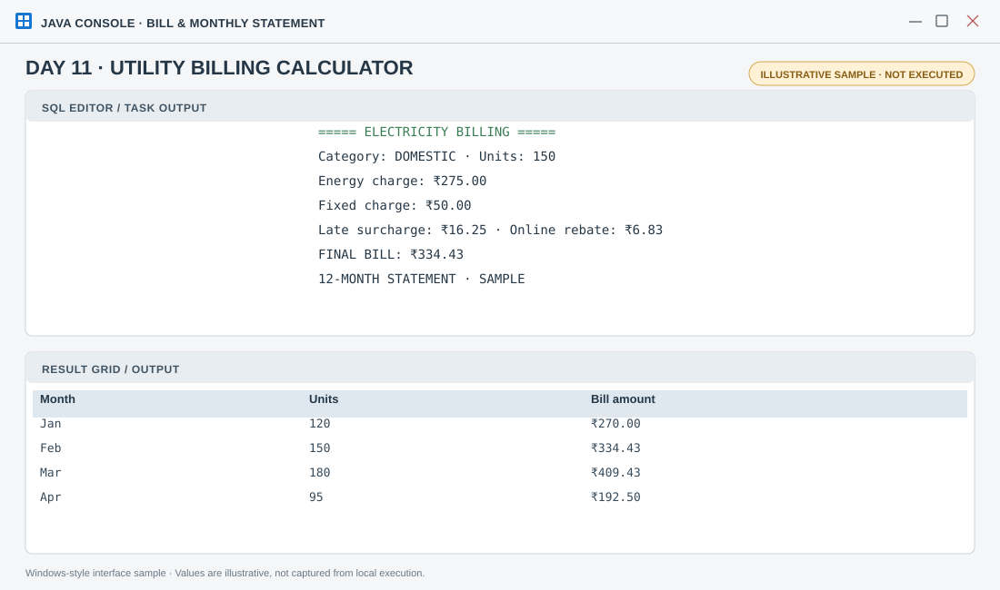

# Day 11 – Utility Billing Calculator

## Objective
Build an electricity bill calculator using consumption slabs, customer category, late-payment surcharge and online-payment rebate.

**Selected assignment:** Set 2 – Utility Billing Calculator.

## Files
- src/day11/utilitybilling/UtilityBillingApp.java – complete Java program.
- sample_runs.md – illustrative run and calculation.
- boundary_tests.csv – boundary values 100, 101, 200, 201, 400 and 401.
- concepts.md – beginner notes on switch expressions, loops, operators and casting.

## Prerequisites
Install JDK 25. Check the installation:
    java -version
    javac -version

Open a terminal inside this folder and compile/run:
    javac -d out src/day11/utilitybilling/UtilityBillingApp.java
    java -cp out day11.utilitybilling.UtilityBillingApp

## Sample tariff assumptions
The assignment sheet specifies slab ranges but does not specify numerical rates or fixed charges. To make the program runnable, this practice solution uses:
- 0–100 units: ₹1.50 per unit
- 101–200 units: ₹2.50 per unit
- 201–400 units: ₹4.00 per unit
- Above 400 units: ₹6.00 per unit
- Fixed charge: Domestic ₹50, Commercial ₹150, Industrial ₹300
- Late surcharge: 5%; online rebate: 2%

These are practice values, not official electricity-board tariffs. The program applies progressive slabs: each portion of consumption uses its own rate.

## Program flow
1. Enter category, units and payment details to calculate one bill.
2. The for loop prints a 12-month sample statement.
3. The do-while loop accepts meter readings until 0 is entered.
4. The program prints primitive-casting examples.

## Illustrative task output

The image below is a **clearly labelled illustrative sample**, not a screenshot captured from an actual local execution. Use it as a visual reference for the expected layout and type of output.

