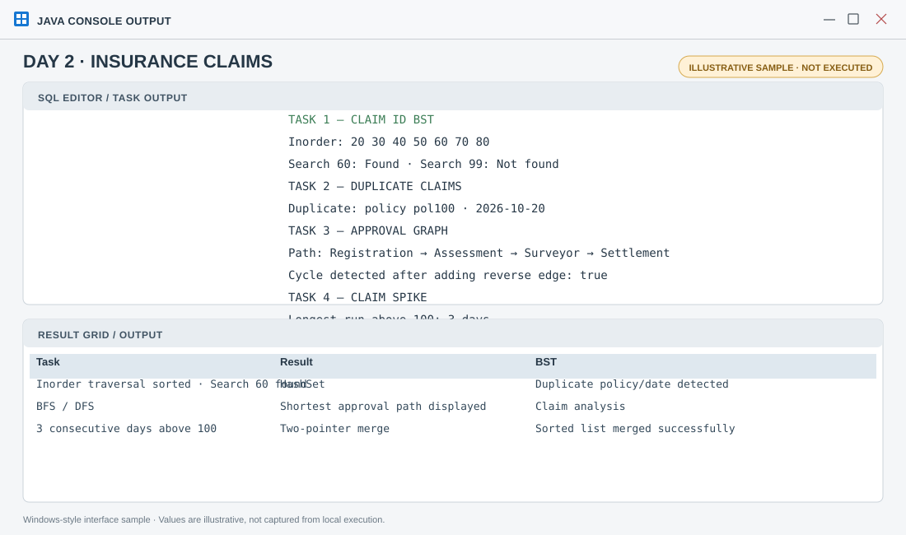

# Day 2 — Insurance Claims Processing (Set 2)

Beginner-friendly Java implementation of the Hexaware Day 2 assignment.

## Topics
- Binary Search Tree
- Hashing with HashSet
- Directed graphs, BFS and DFS
- Longest consecutive run using a single-pass sliding-window-style counter
- Two-pointer merge of sorted lists

## Run
```bash
javac src/main.java
java -cp src main
```

See `notes/notes.md` for the decision table, complexity analysis, test cases and sample output.

## Illustrative task output

The image below is a **clearly labelled illustrative sample**, not a screenshot captured from an actual local execution. Use it as a visual reference for the expected layout and type of output.


