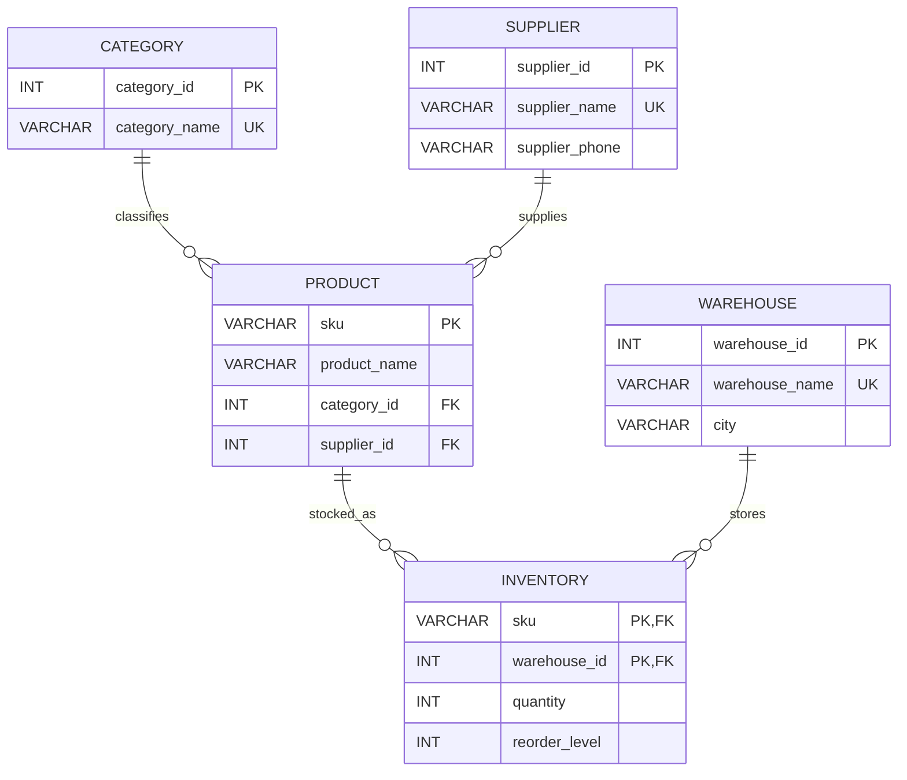

# ER Diagram – Retail Inventory Management

## Relationships
- One category can classify many products; each product belongs to one category.
- One supplier can supply many products; each product references one supplier.
- One product can have inventory records in multiple warehouses.
- One warehouse can store many products.
- `inventory` resolves the many-to-many relationship between products and warehouses. Its composite primary key is `(sku, warehouse_id)`.

## Keys
- Primary keys: `category_id`, `supplier_id`, `warehouse_id`, `sku`, and composite `(sku, warehouse_id)`.
- Foreign keys: `product.category_id`, `product.supplier_id`, `inventory.sku`, `inventory.warehouse_id`.
- Unique keys: category name, supplier name and warehouse name.
