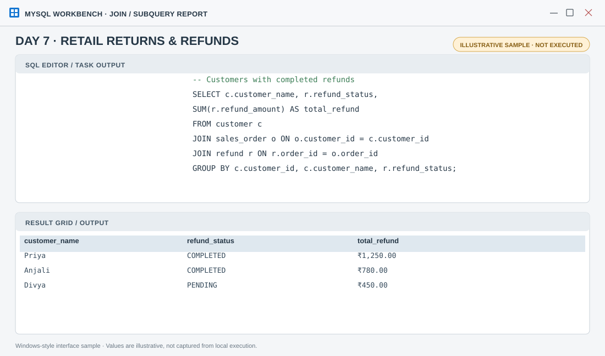

# Day 7 – Retail Returns and Refunds

**Selected assignment:** Set 3 – Retail Returns and Refunds  
**Database:** MySQL 8.4  
**Scenario:** Analyse product returns, customer refunds and store operations

## Objective
Use retail transaction data to answer business questions about returned products, refund status and refund values. The exercises also demonstrate employee reporting relationships and different ways to express conditions using joins and subqueries.

## Files in this folder
| File | Purpose |
|---|---|
| `advanced_reports.sql` | Business-report queries using joins, IN, EXISTS, NOT EXISTS, ANY, ALL and nested subqueries |
| `join_and_subquery_notes.md` | Explains the join choices, subquery patterns, NULL-related behaviour and expected sample-result checks |

## Prerequisites
This folder uses the retail tables and sample records created for Day 6. Complete the following before running Day 7:

1. In `Day5_Retail_Inventory_Management`, execute `schema.sql` and `seed_data.sql`.
2. In `Day6_Retail_Sales_Reporting`, execute `setup.sql` and then `seed_data.sql`.

Do not create another copy of the shared tables. Run all scripts against the same MySQL database.

## How to run
1. Open `advanced_reports.sql` in MySQL Workbench.
2. Execute the queries and inspect each result.
3. Read `join_and_subquery_notes.md` to understand why each join or subquery is used.

## Important notes
- The `NOT IN` condition can behave unexpectedly when its subquery returns NULL. The notes explain the NULL-safe alternative using `NOT EXISTS`.
- The SQL files contain query examples; execute them after the prerequisites have created and populated the required tables.
- Expected-result descriptions are guidance and may vary if you change the sample data.

## Illustrative task output

The image below is a **clearly labelled illustrative sample**, not a screenshot captured from an actual local execution. Use it as a visual reference for the expected layout and type of output.

